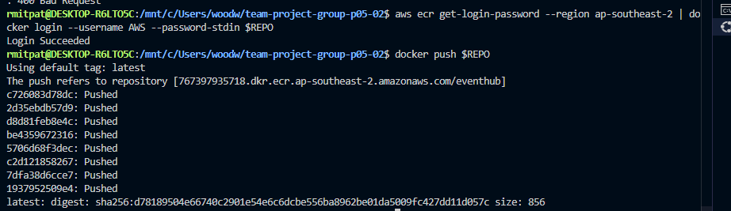
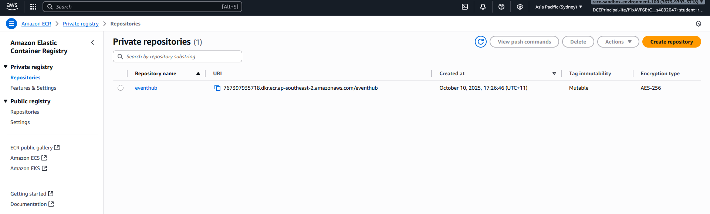
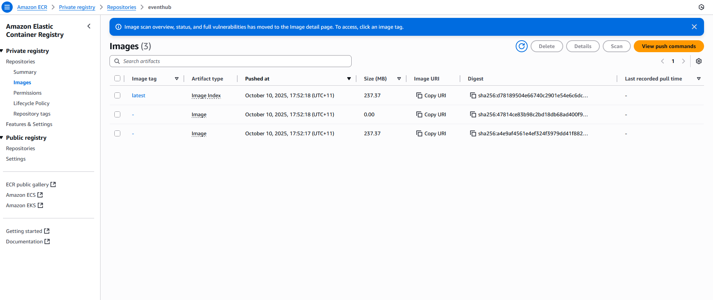

## Github Board Structure

- Issues are generally user stories, click on them to find sub-task with story points (hours) breakdown.

## Test Accounts

- admin@example.com admin ADMIN
- loi.andrew@example.com tDN2l2:.041` STUDENT
- lay.aaron@example.com 0?04W!RgzEN9 ORGANISER
- ly.patrick@example.com 7Fig92i3B<z< ADMIN

## Sprint 3 status

We have marked the features user notifications and event ticket QR codes as undeliverable due to a lack of time. This is reflected in the project board and SRS document.

## Docker images deployed to AWS ECR

As part of the optional advanced features, we have pushed our docker images to AWS ECR. Here is the proof:

image-1 shows the successful docker push along with the repo URI link.
image-2 shows the same URI link in my ECR private registry.
image-3 shows the docker images within that repository.

