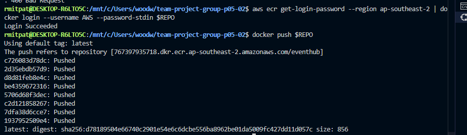
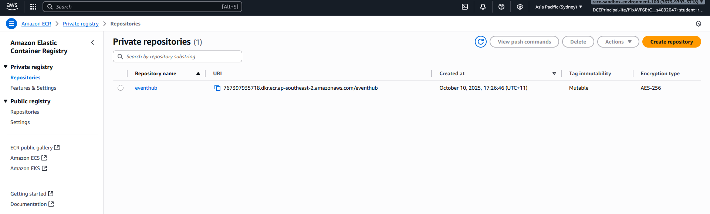
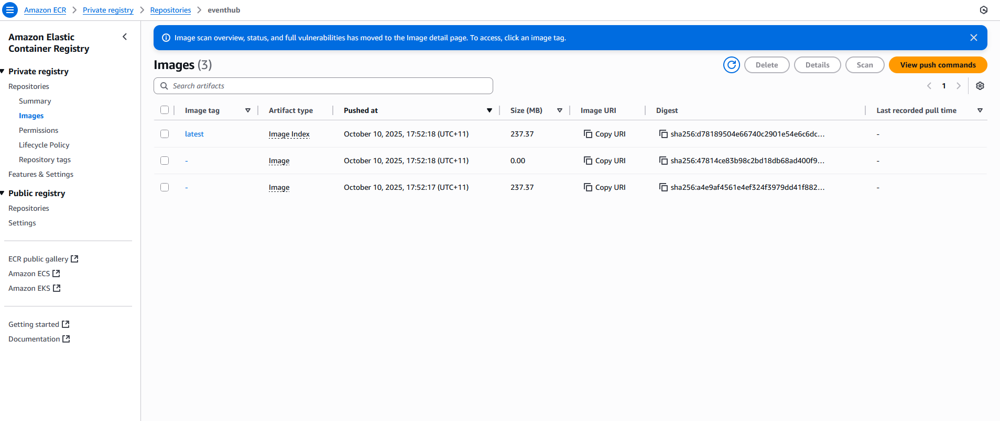

# RMIT COSC2299 SEPT Major Project

# Group Information

## Group-P05-02

## Members

- Patrick Ly (s4092047)
- Brody Watson (s4040831)
- Aaron Lay (s4008286)
- Aaron Tran (s4094187)
- Donovan Ong (s4029371)
- Andrew (s4095942)

## Records

- Github repository: https://github.com/cosc2299-2025/team-project-group-p05-02
- Github Project Board : https://github.com/orgs/cosc2299-2025/projects/147
- Microsoft Teams : https://teams.microsoft.com/l/channel/19%3AKahmTSQCpnJvqlvxgW0AIInQh8ysFV5Jeabjc3TCPMQ1%40thread.tacv2/General?groupId=f8cb2711-ff53-4229-bcfc-35ca8dfeaa89&tenantId=d1323671-cdbe-4417-b4d4-bdb24b51316b
  See [Instructions](INSTRUCTIONS.md)

## Test Accounts

- admin@example.com admin ADMIN
- loi.andrew@example.com tDN2l2:.041` STUDENT
- lay.aaron@example.com 0?04W!RgzEN9 ORGANISER
- ly.patrick@example.com 7Fig92i3B<z< ADMIN

## Docker Commands

Build: docker-compose -f docker-compose-mysql.yml build
Run: docker-compose -f docker-compose-mysql.yml --env-file compose-vars.env up

## Tests

To run tests: ./mvnw test or mvn test depending on your device

## Payment

For a successful payment: set card number as 4242 4242 4242 4242
For an unsuccessful payment: set card number as 4000 0000 0000 2685  
CVC and card holder can be anything

image-1 shows the successful docker push along with the repo URI link.
image-2 shows the same URI link in my ECR private registry.
image-3 shows the docker images within that repository.

